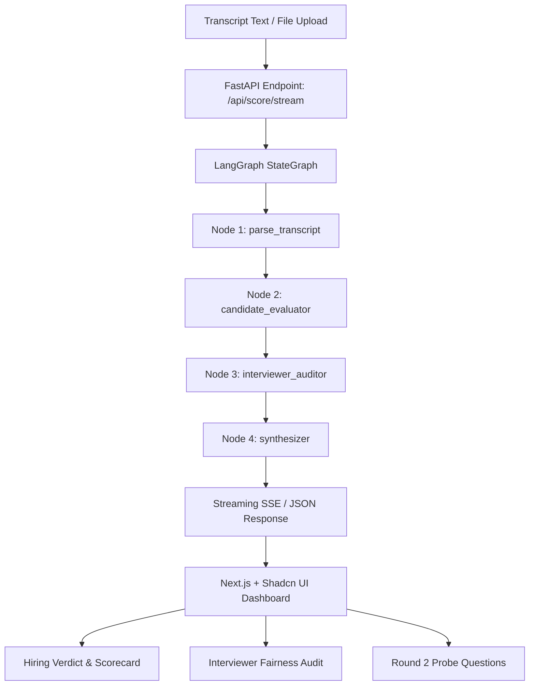

# 🎙️ InterviewScorerAI

**InterviewScorerAI** is an AI-powered application designed to objectively assess real human-to-human interview transcripts. Built with a multi-stage **LangGraph** orchestration workflow, **FastAPI**, **Next.js (App Router)**, and **Shadcn UI**, it evaluates candidate competencies across multiple dimensions while simultaneously auditing the interviewer for fairness, confirmation bias, and conversational pacing.

---

## 🌟 Key Features

### 1. Multi-Stage LangGraph Assessment Pipeline
- **Transcript Parser & Dynamics Node**: Extracts speaker turns, normalizes roles, and computes conversational statistics (candidate vs. interviewer talk-time ratio, word counts, questions asked).
- **Candidate Evaluator Node**: Scores candidates from 1 to 10 across 5 core dimensions:
  1. *Technical & Domain Competence*
  2. *Problem Solving & Analytical Rigor*
  3. *Communication & Structured Articulation (STAR method)*
  4. *Behavioral & Cultural Alignment*
  5. *Confidence, Composure & Adaptability*
  - Grounds every score with **direct verbatim quote citations** from the transcript.
- **Interviewer Calibration & Bias Auditor Node**:
  - Audits interviewer questions for clarity and relevance.
  - Detects confirmation bias, leading questions (e.g. *"Don't you think X is the obvious fix?"*), and premature interruptions.
  - Provides actionable coaching tips for interviewers.
- **Synthesizer Node**:
  - Produces composite score (1–100), hire recommendation (*Strong Hire*, *Hire*, *Lean Hire*, *Lean Reject*, *Strong Reject*), and next-round decision (*Advance to Next Round*, *Needs Committee Review*, *Reject*).
  - Generates targeted follow-up probe questions for Round 2.

### 2. Real-Time Streaming & Full Transcript Viewer
- **Server-Sent Events (SSE)**: Streams node-by-node execution progress to the frontend with live animated progress bars and execution logs.
- **Interactive Transcript Dialogue**: Browse conversations with speaker-colored bubbles, search filters, and word count metrics.
- **Preloaded Realistic Presets**: One-click test scenarios including:
  1. *Senior Distributed Systems Engineer* (Strong Hire - High technical depth, idempotent APIs, Kafka).
  2. *Senior Product Manager* (Lean Hire / Committee Review - Strong vision but weak metrics, interviewer leading questions).
  3. *Machine Learning Engineer* (Strong Reject - Fundamental data leakage errors, impatient interviewer).

---

## 🏗️ Architecture



---

## 🚀 Getting Started

### ⚡ Quick Start (Single Command)
Run both the FastAPI backend and Next.js frontend with one simple command:

```bash
python run.py
```
This script will:
- Automatically find available ports (e.g. 8000/8001 for backend, 3000/3001 for frontend)
- Launch the FastAPI server using the virtual environment
- Launch the Next.js development server
- Handle clean, graceful shutdown of all processes when you press `Ctrl+C`

#### Optional CLI Flags:
```bash
python run.py --backend-only      # Run only the FastAPI backend
python run.py --frontend-only     # Run only the Next.js frontend
python run.py --backend-port 8001 --frontend-port 3001  # Specify custom ports
```

---

### Manual Step-by-Step Setup (Alternative)

```bash
cd backend

# Create and activate virtual environment
python -m venv venv
# Windows:
.\venv\Scripts\activate
# Linux/macOS:
# source venv/bin/activate

# Install dependencies
pip install -r requirements.txt

# (Optional) Set your API Key in .env
# Copy .env.example to .env and set GEMINI_API_KEY or OPENAI_API_KEY
# If no API key is provided, the system gracefully uses the built-in analytical engine!

# Start FastAPI server
uvicorn app.main:app --host 0.0.0.0 --port 8000 --reload
```
The FastAPI documentation will be available at: `http://localhost:8000/docs`.

### 2. Frontend Setup (Next.js + Shadcn UI)

```bash
cd frontend

# Install dependencies
npm install

# Start Next.js development server
npm run dev
```
Open your browser at `http://localhost:3000`.

---

## 📋 API Endpoints

| Method | Endpoint | Description |
|---|---|---|
| `GET` | `/api/health` | Health status and supported LLM providers |
| `GET` | `/api/samples` | List preloaded real-world interview transcripts |
| `POST` | `/api/score` | Synchronous interview assessment |
| `POST` | `/api/score/stream` | Real-time Server-Sent Events (SSE) streaming evaluation |
| `POST` | `/api/upload` | Extracts text from uploaded `.txt`, `.vtt`, `.srt`, `.json` transcripts |

---

## 🛡️ License
MIT License.
